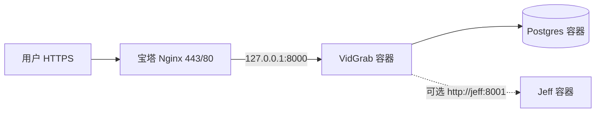

# SmartDiagram 视频学习助手 (`v2.7.0`) 宝塔面板生产部署指南

> **适用场景**：在已安装 [宝塔 Linux 面板](https://www.bt.cn/) 的云服务器（阿里云 / 腾讯云 / 华为云等）上，部署 SmartDiagram 统一平台或视频学习助手 (`apps/api-video :4020` / 统一网关 `:9237`) 生产环境。  
> **v2.7.0 架构说明**：视频学习助手已融合进 SmartDiagram Monorepo（前端 `apps/web/src/features/video/` React 18 + TS，后端 `apps/api-video :4020`，系统 1 `Jeff :8001`，数据库 PostgreSQL 16 `vidgrab`）。生产环境推荐使用根仓库 `./deploy.sh` 统一网关（`:9237`）+ 宝塔 Nginx 反代与 HTTPS（开启 `proxy_cache off; proxy_buffering off;` 保障 HTTP 206 Range 视频秒级跳转与 SSE 流式问答）。

**延伸阅读**（部署完成后按需阅读）：

| 文档 | 内容 |
|------|------|
| [Docker 内部部署](Docker内部部署.md) | 镜像构建、卷挂载、健康检查 |
| [宝塔域名 HTTPS 与 GitHub 自动部署](宝塔域名HTTPS与GitHub自动部署.md) | Nginx 细节、Let's Encrypt、GitHub Actions |
| [系统1决策模型-Jeff本地部署与毫秒级意图路由](系统1决策模型-Jeff本地部署与毫秒级意图路由.md) | Jeff 意图路由原理与调优 |

---

## 一、方案选择（简要）

| 方案 | 说明 | 推荐度 |
|------|------|--------|
| **A. Docker Compose + 宝塔反代** | 与仓库 `compose.yaml` 一致：Postgres + VidGrab 主容器 +（可选）Jeff；宝塔绑定域名与 SSL | ⭐⭐⭐⭐⭐ **采用** |
| B. 宝塔「网站目录」托管静态 `dist` | 旧式拆前后端，SSE/流式字幕、登录态、API 路径易错 | ❌ 不推荐 |
| C. 宝塔内手工装 Python/Node | 依赖多、与仓库交付方式不一致 | ❌ 仅本地开发 |

**生产拓扑**：



---

## 二、服务器与软件前置条件

### 2.1 硬件与系统

| 项 | 建议 |
|----|------|
| CPU / 内存 | **2 核 4 GB** 起；启用 Jeff + 频繁 FFmpeg 转码建议 **4 核 8 GB** |
| 磁盘 | 系统盘 ≥ 40 GB；视频归档多请单独挂数据盘 |
| 系统 | Alibaba Cloud Linux 3 / Ubuntu 22.04 / CentOS 7+（宝塔官方支持列表内） |

### 2.2 必装组件

1. **宝塔面板**（安装后先改默认端口、绑定安全入口、限制面板 IP）
2. **Docker** 与 **Docker Compose 插件**  
   - 宝塔：**软件商店 → 搜索 Docker → 安装**  
   - 或 SSH：`docker compose version` 能输出版本即可
3. **Git**（宝塔终端或 `yum`/`apt` 安装）

### 2.3 端口与安全（云厂商安全组 + 宝塔防火墙）

| 端口 | 对公网 | 说明 |
|------|--------|------|
| **80 / 443** | 开放 | HTTP 跳转与 HTTPS |
| **22** | 建议仅办公 IP | SSH |
| **8888**（或自定义面板端口） | 建议仅办公 IP | 宝塔面板 |
| **8000** | **禁止** | VidGrab；仅本机 `127.0.0.1` 访问 |
| **8001** | **禁止** | Jeff |
| **15432** | **禁止** | Postgres 宿主机映射（compose 已绑 `127.0.0.1`） |

---

## 三、部署目录与拉取代码

建议使用与 CI/CD 脚本一致的路径 **`/opt/free-video-downloader`**（可改，但后文命令需同步修改）。

在 **宝塔 → 终端** 或 SSH 中执行：

```bash
sudo mkdir -p /opt
sudo chown "$USER":"$USER" /opt
cd /opt
git clone https://github.com/24205345/free-video-downloader.git
cd free-video-downloader
git checkout main
git pull
```

国内克隆慢时，可改用你的镜像仓库或 Gitee 同步源，只要目录结构与 `compose.yaml` 一致即可。

---

## 四、生产环境变量 `.env.docker`

```bash
cd /opt/free-video-downloader
cp .env.docker.example .env.docker
chmod 600 .env.docker
```

用宝塔 **文件** 编辑器或 `vim` 至少修改以下项：

| 变量 | 要求 |
|------|------|
| `AUTH_JWT_SECRET` | 随机长串，例如：`python3 -c "import secrets; print(secrets.token_hex(32))"` |
| `POSTGRES_PASSWORD` | 强密码；与 `DATABASE_URL` 中密码一致 |
| `INITIAL_ADMIN_EMAIL` / `INITIAL_ADMIN_PASSWORD` | 首次启动自动创建的管理员（已存在账号会提权为 admin） |
| `APP_BASE_URL` | **对外 HTTPS 根地址**，如 `https://vidgrab.example.com`（影响邮件链接、Stripe 回调等） |
| `AUTH_ALLOWED_EMAIL_DOMAINS` | 注册邮箱后缀限制；留空表示不限制 |
| `LLM_*` / `ASR_*` / `DEEPSEEK_*` 等 | 按需填写 AI 能力（见 `local.env.example` 注释） |

### 4.1 Jeff 意图路由（二选一）

**启用 Jeff（推荐，需额外约 1.2 GB 内存）**：

1. 下载模型到项目 `models/`（需能访问 HuggingFace，可设镜像 `HF_ENDPOINT`）：

```bash
cd /opt/free-video-downloader
python3 scripts/download_jeff_model.py
```

2. 在 **`.env.docker`** 中增加（容器间通信用服务名，不要用 `127.0.0.1`）：

```env
INTENT_ROUTER_ENABLED=true
TYPESAFE_BASE_URL=http://jeff:8001
TYPESAFE_API_KEY=devkey
INTENT_ROUTER_TIMEOUT=0.5
```

`compose.yaml` 里 Jeff 默认 `JEFF_API_KEYS=devkey`，请与 `TYPESAFE_API_KEY` 保持一致；生产环境请改成随机密钥并同步改 compose 中 `JEFF_API_KEYS`。

**暂不启用 Jeff**（少一个容器、省内存）：

```env
INTENT_ROUTER_ENABLED=false
```

此时可只启动 `postgres` 与 `vidgrab`：

```bash
docker compose up -d postgres vidgrab
```

---

## 五、首次构建与启动容器

### 5.1 国内服务器加速（可选）

仓库提供一键脚本，会改写 Dockerfile 国内基础镜像与 pip 源并执行构建：

```bash
cd /opt/free-video-downloader
bash scripts/deploy-ecs.sh
```

### 5.2 手动构建（与脚本等价）

```bash
cd /opt/free-video-downloader
docker compose up --build -d
docker compose ps
curl -sf http://127.0.0.1:8000/api/health && echo " OK"
```

期望：`vidgrab-postgres`、`vidgrab`（及启用 Jeff 时的 `vidgrab-jeff`）为 **running / healthy**。

### 5.3 数据持久化说明

Docker 卷（无需手工建目录）：

- `vidgrab-pgdata`：PostgreSQL 数据
- `vidgrab-data`：视频归档等 `/app/data`
- `vidgrab-downloads`：下载临时目录

**更新代码时不要删除上述卷**，也不要用 git 覆盖 `.env.docker`。

---

## 六、宝塔建站与反向代理

### 6.1 添加站点

1. **网站 → 添加站点**  
   - 域名：你的正式域名（如 `vidgrab.example.com`）  
   - 根目录：任意（例如 `/www/wwwroot/vidgrab`），**不会用来放前端静态文件**  
   - PHP：纯静态或关闭 PHP 均可  

2. **SSL → Let's Encrypt**（或上传已有证书）  
   - 开启 **强制 HTTPS**

### 6.2 反向代理到容器

**网站 → 设置 → 反向代理 → 添加反向代理**  

- 目标 URL：`http://127.0.0.1:8000`  
- 发送域名：`$host`  

在 **配置文件** 中确认 `location /` 包含（流式字幕/SSE 必须关闭缓冲）：

```nginx
location / {
    proxy_pass http://127.0.0.1:8000;
    proxy_set_header Host $host;
    proxy_set_header X-Real-IP $remote_addr;
    proxy_set_header X-Forwarded-For $proxy_add_x_forwarded_for;
    proxy_set_header X-Forwarded-Proto $scheme;

    proxy_buffering off;
    proxy_read_timeout 600s;
    proxy_send_timeout 600s;

    proxy_http_version 1.1;
    proxy_set_header Upgrade $http_upgrade;
    proxy_set_header Connection "upgrade";

    client_max_body_size 512m;
}
```

大文件上传失败时，可在同一 `server` 块适当增大 `client_max_body_size`。

### 6.3 验证外网访问

浏览器打开 `https://你的域名/`，应看到 VidGrab 前端；  
`https://你的域名/api/health` 应返回健康 JSON。

---

## 七、日常更新与回滚

### 7.1 手工更新

```bash
cd /opt/free-video-downloader
git pull
bash scripts/deploy-ecs.sh
# 或: docker compose up --build -d
```

### 7.2 自动化（可选）

配置 GitHub Actions 与 rsync，见 [宝塔域名 HTTPS 与 GitHub 自动部署](宝塔域名HTTPS与GitHub自动部署.md)。  
同步时必须 **排除** `.env.docker` 与业务数据目录，避免覆盖生产密钥与数据库。

### 7.3 回滚

```bash
cd /opt/free-video-downloader
git log -5 --oneline
git checkout <上一个稳定 commit>
docker compose up --build -d
```

数据库在 Docker 卷内，回滚代码不会自动回滚 PG 结构；大版本升级前建议用 `pg_dump` 备份。

---

## 八、验收清单

| # | 检查项 | 预期 |
|---|--------|------|
| 1 | `curl http://127.0.0.1:8000/api/health` | 成功 |
| 2 | HTTPS 首页 | 证书有效、无混合内容报错 |
| 3 | 管理员登录 | `INITIAL_ADMIN_*` 账号可登录 |
| 4 | 注册策略 | 非允许域名被拦截（若配置了 `AUTH_ALLOWED_EMAIL_DOMAINS`） |
| 5 | 流式能力 | 总结/字幕进度条能持续更新（若 Nginx 开了 `proxy_buffering off`） |
| 6 | 公网端口扫描 | 8000/8001/15432 不可从外网直连 |

---

## 九、常见问题

### 9.1 502 Bad Gateway

- 容器未起：`docker compose ps`、`docker compose logs vidgrab --tail 100`  
- 反代地址错误：必须是 **`127.0.0.1:8000`**，不是容器 IP  
- 构建失败：内存不足时 Jeff 或 Node 构建阶段 OOM，考虑加 swap 或关闭 Jeff

### 9.2 健康检查失败 / 数据库连不上

- 确认 `postgres` 为 healthy 后再看 `vidgrab` 日志  
- 检查 `.env.docker` 中 `POSTGRES_PASSWORD` 与 compose 默认是否一致  

### 9.3 Jeff 一直降级 / 意图路由超时

- `.env.docker` 中 `TYPESAFE_BASE_URL` 应为 **`http://jeff:8001`**（Docker 网络内）  
- 确认 `models/gliformer-large-v1` 已下载且 compose 挂载 `./models:/models`  
- `docker compose logs jeff --tail 50`

### 9.4 AI 总结 / 转写不可用

- 在 `.env.docker` 配置 LLM/ASR 密钥（参考 `local.env.example`）  
- 查看 `docker compose logs vidgrab` 中 LLM 调用报错  

### 9.5 磁盘占满

- 调整 `VIDEO_STORAGE_MAX_GB`  
- 清理 Docker：`docker system df`，谨慎 `docker volume prune`（会删未使用卷）

---

## 十、执行记录（本文档维护）

| 日期 | 说明 |
|------|------|
| 2026-10-13 | 初版：对齐 `compose.yaml`（Postgres + VidGrab + 可选 Jeff）；明确「禁止宝塔单独托管 dist」；补充 Docker 内 Jeff 的 `TYPESAFE_BASE_URL=http://jeff:8001` |

**经验摘要（宝塔 + Docker 类项目）**：

1. 宝塔只承担 **域名、证书、反代**；业务进程统一进 Compose，避免双轨部署。  
2. 反代务必 **`proxy_buffering off`**，否则 SSE/流式 AI 会「卡住后一次性出来」。  
3. 容器间服务用 **Compose 服务名** 通信；宿主机 `127.0.0.1:8001` 在 VidGrab 容器内指向自身，不能代替 Jeff 容器。
