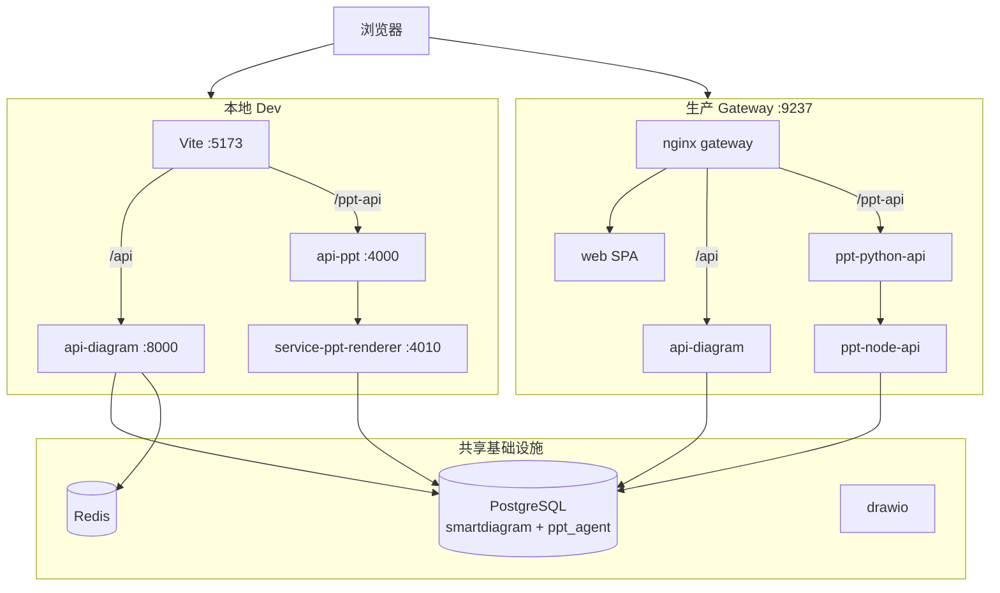

# SmartDiagram 架构 A 文档

> **用途**：架构真相源；AI Agent **先读 [`AGENTS.md`](./AGENTS.md)**，再读本文建立全局地图。  
> **版本**：0.2.0 · **更新**：2026-07-26 · **状态**：与当前 monorepo 对齐

---

## 0. 30 秒速览

| 维度 | 事实 |
|------|------|
| **产品** | 统一桌面式 SPA：`/` 首页 · `/diagram` 智能图表 · `/recruit` AI 招聘筛选（AI 找人才 / ATS） · `/ppt` AI 演示文稿 · `/video` 视频学习助手 |
| **形态** | npm/pnpm monorepo，**一个前端 + 三个后端域 + 网关聚合** |
| **本地** | `npm run dev` → Vite `:5173`，API 由 Vite proxy 分流 |
| **生产** | `gateway :9237` 唯一入口，nginx 分流 SPA / 图表 API / PPT API / Video API / draw.io |
| **数据库** | **三库（同一 PG 实例）**：`smartdiagram`（图表）+ `ppt_agent`（PPT，Prisma）+ `vidgrab`（视频学习助手） |
| **配置** | **唯一主配置** 根目录 `.env`（Platform / Diagram / PPT / Video 四分区） |

---

## 1. 设计原则（改代码前先理解）

1. **平台 + 业务模块**：`apps/web` 是统一壳；`/diagram`、`/recruit` 与 `/ppt` 是平级业务模块，通过 `modules/registry.tsx` 注册，新增模块只加注册 + 路由。
2. **API 前缀隔离**：图表走 `/api/*` → `api-diagram`；PPT 走 `/ppt-api/*` → `api-ppt`（Python 编排）→ `service-ppt-renderer`（Node 渲染侧车）。
3. **环境变量单源**：根 `.env` 为唯一真相；`apps/*/.env` 仅本机临时覆盖。部署脚本会合并旧 env、校验、自动生成密钥。
4. **LangGraph 编排**：图表与 PPT 均用 Agent 图；路由按 task/engine 分发，SSE 流式输出 `<design_concept>` + `<code>`。
5. **企业能力可选**：知识库、异步导出、worker 队列依赖 PostgreSQL + Redis；`--with-worker` 才启 worker 容器。

---

## 2. 目录地图（改哪里一目了然）

```
SmartDiagram/
├── apps/
│   ├── web/                      # 统一 SPA（React 18 + Vite + Tailwind v4）
│   │   └── src/
│   │       ├── app/main.tsx      # 路由入口：/ · /diagram/* · /recruit/* · /ppt/*
│   │       ├── modules/registry.tsx   # 模块注册表（导航 + 首页卡片）
│   │       ├── pages/            # 平台页（home、diagram workspace）
│   │       ├── features/
│   │       │   ├── diagram/      # 图表：chatStore、Canvas、ChatPanel
│   │       │   ├── recruit/      # AI 招聘 ATS：岗位、候选人、面试、统计
│   │       │   ├── ppt/          # PPT：五步工作流、workbenchStore、api.ts
│   │       │   └── video/        # 视频学习：工作台、导图、双语字幕、测验、历史与后台
│   │       └── shared/           # AppShell、auth、settings、macOS 桌面 UI
│   │
│   ├── api-diagram/              # 图表 FastAPI + LangGraph（:8000）
│   │   └── app/
│   │       ├── main.py           # 路由挂载（chat/auth/knowledge/exports/…）
│   │       ├── api/routes.py     # SSE /api/chat/stream 主入口
│   │       ├── agents/           # orchestrator、router、各 engine agent
│   │       ├── services/         # 持久化、知识库、导出、队列、计费…
│   │       └── models/           # SQLAlchemy 模型（smartdiagram 库）
│   │
│   ├── api-ppt/                  # PPT Python 编排 FastAPI（:4000）
│   │   └── src/ppt_agent_api/    # LangGraph 工作流、对 Node 侧车 HTTP 调用
│   │
│   ├── service-ppt-renderer/     # PPT Node 侧车（:4010）
│   │   └── Prisma + PPTX 渲染 + 资料存储
│   │
│   └── api-video/                # 视频学习助手 FastAPI（:4020，/video-api/*）
│       └── main.py / summarizer.py / downloader.py / quiz_generator.py / migrations/
│
├── packages/
│   ├── slide-ir/                 # PPT IR 与 SmartSlide DSL
│   ├── shared/                   # PPT 共享类型（goalSpec 等）
│   ├── agents/                   # PPT Agent 逻辑（TS）
│   └── ppt-renderer/             # PPTX 渲染核心
│
├── prisma/                       # ppt_agent 库迁移（DATABASE_URL）
├── gateway/
│   ├── nginx.conf                # 生产分流规则
│   └── dev-gateway.mjs           # 本地 gateway 模式（start-all.sh）
│
├── scripts/                      # dev-common、env 校验、bootstrap 密钥、db-wait
├── dev.sh                        # npm run dev 入口
├── deploy.sh                     # 生产部署 / 更新
├── migrate.sh                    # 跨服务器一键迁移 / 恢复部署入口
├── host-db.sh                    # 复用宿主机 PostgreSQL 的迁移 / 部署入口
├── docker-compose.yml            # 全栈容器定义
├── docker-compose.host-db.yml    # 宿主机 PostgreSQL 覆盖配置（仅运行数据库客户端）
├── .env / .env.example           # 唯一主配置（三分区）
└── README.md                     # 人类操作手册
```

---

## 3. 运行时拓扑

### 3.1 本地开发（`npm run dev` → `dev.sh`）

```
浏览器 :5173 (apps/web, Vite HMR)
  ├─ /api/*        ──proxy──► api-diagram      :8000
  ├─ /ppt-api/*    ──proxy──► api-ppt          :4000
  │                                 │
  │                                 └──HTTP──► service-ppt-renderer :4010
  └─ /video-api/*  ──proxy──► api-video        :4020 (──► Jeff :8001)

Docker（基础设施）:
  db:5432 (smartdiagram + ppt_agent)
  redis:6379
  drawio:9022 → iframe 嵌入 Draw.io 画布
```

### 3.2 生产（`./deploy.sh --with-worker`）

```
gateway :9237 (nginx)
  ├─ /              → web（静态 SPA）
  ├─ /api/          → api-diagram:8000
  ├─ /ppt-api/      → ppt-python-api:4000 → ppt-node-api:4010
  ├─ /drawio/       → drawio
  └─ worker profile → smartdiagram-worker（企业异步任务）

外部只暴露 GATEWAY_PORT（默认 9237）；web/api 走 Docker 内网。
```



---

## 4. 前端架构

### 4.1 路由（`apps/web/src/app/main.tsx`）

| 路径 | 组件 | 说明 |
|------|------|------|
| `/` | `HomePage` | 模块入口卡片 |
| `/diagram/*` | `DiagramWorkspace` | 图表工作台（画布 + 聊天） |
| `/recruit/*` | `RecruitModule` | 招聘工作台（AI 找人才初筛 / 岗位 / 候选人 / 面试 / 统计） |
| `/ppt/*` | `PptModule` | PPT 五步工作流 |
| `/video/*` | `VideoModule` | 视频学习工作台（上传/链接解析、研报、导图、双语字幕、问答、测验、历史与后台） |

所有路由包在 `AppShell` 内（macOS 风格菜单栏、Spotlight、设置），由 `shared/ui/shell/KeepAliveOutlet.tsx`（`KeepAliveWorkspace`）结合 `shared/store/desktopStore.ts` 按需挂载并保活各业务模块（冻结后台模块 `LocationContext`、持久化各模块最后停留的子路由到 `sessionStorage`、切入后台自动暂停音视频、切回前台触发尺寸校准）。

### 4.2 模块注册（`modules/registry.tsx`）

新增业务模块：**只改两处** — `moduleRegistry` 加一条 + `main.tsx` 挂 Route。导航栏与首页自动读取注册表。

### 4.3 图表前端（`features/diagram/`）

| 关注点 | 文件 |
|--------|------|
| 状态 | `model/chatStore.ts`（Zustand：messages、canvasAgent、SSE 流） |
| 聊天 | `ui/chat/ChatPanel.tsx` |
| 画布路由 | `ui/layout/CanvasPanel.tsx` → 各 `*Canvas.tsx` |
| Agent 元数据 | `shared/lib/config/diagramAgents.ts` |
| 历史/导出 | `model/diagramHistory.ts`、`ui/ExportButton.tsx` |

**Canvas 与 Engine 对应**（须与后端 `agents/catalog.py` 一致）：

| Engine | Canvas 组件 | 输出形态 |
|--------|-------------|----------|
| excalidraw | ExcalidrawCanvas | Excalidraw JSON |
| mermaid | MermaidCanvas | Mermaid DSL |
| flow | FlowCanvas | React Flow JSON |
| mindmap | MindmapCanvas | Markdown 层级 |
| charts | ChartsCanvas | ECharts option |
| drawio | DrawioCanvas | draw.io XML（iframe） |
| infographic | InfographicCanvas | AntV Infographic |
| html_email / web_report_html | ArtifactCanvas | HTML artifact |

### 4.4 PPT 前端（`features/ppt/`）

| 空间 | 页面 | 职责 |
|------|------|------|
| Intent | `IntentSpace` | 资料上传、Brief、视觉意图 |
| Structure | `StructureSpace` | 大纲便利贴 |
| Studio | `StudioSpace` | 单页 AI 设计与预览 |
| Exports | `ExportsSpace` | PPTX / 视频导出 |

API 封装：`lib/api.ts`（base = `/ppt-api`）。状态：`store/workbenchStore.ts`。
Studio 设计稿按页懒加载最近 5 个 `SlideDesignVersion`；版本导航切换会同步
`activeDesignVersionId` 与 `svgPreview`，因此预览、代码编辑器和导出始终读取同一当前版本。

### 4.5 AI 招聘前端（`features/recruit/`）

| 关注点 | 文件 |
|--------|------|
| 模块入口 | `RecruitModule.tsx` + `components/RecruitShell.tsx` |
| 首页 / Dashboard | `pages/RecruitHomePage.tsx` |
| AI 找人才 | `pages/RecruitScreeningPage.tsx`（单份评估）+ `pages/RecruitTalentSearchPage.tsx`（会话恢复、历史与后台搜索轮询）+ `recruit.css` |
| 岗位中心 | `pages/RecruitJobsPage.tsx` + `pages/RecruitJobDetailPage.tsx` |
| 候选人中心 | `pages/RecruitCandidatesPage.tsx` + `pages/RecruitCandidateDetailPage.tsx`（PDF-first、首个岗位默认选中、岗位自动初始化、简历字段预识别） |
| 面试 / 统计 | `pages/RecruitInterviewsPage.tsx` + `pages/RecruitAnalyticsPage.tsx` |
| 简历优化（Resume Lab） | `pages/RecruitResumeLabPage.tsx`（草稿列表 / 新建）+ `pages/RecruitResumeLabEditorPage.tsx`（左 AI 对话、右可编辑简历模板、自动保存、评分迭代）+ `lib/resumeLab.ts` + `resume-lab.css` |
| API 与状态 | `lib/api.ts` + `store/recruitStore.ts` |
| 视觉与动效 | `recruit-theme.css`（Talent Atlas 主题层，覆盖 `recruit.css` token）+ `lib/motion.ts`（GSAP 页面入场，由 `RecruitShell` 按路由触发）+ `components/RecruitUI.tsx`（ScoreRing / MeterBar / Avatar / TalentRadar / AiLoader 等）+ `lib/format.ts`（阶段标签、分档色调） |

招聘页面使用独立的 `recruit` 外壳上下文：`RecruitShell` 不再渲染额外窗口标题栏，AppShell 的 Dock 在招聘工作台中自动隐藏并保留底部唤出边缘。
人才搜索会话由 `api-diagram/app/models/recruit.py` 的 `RecruitSearchConversation` 按已验证的用户/游客身份持久化，`api/routes_recruit.py` 提供 `/api/recruit/search-conversations`，`services/recruit_search_service.py` 在响应后独立执行并写回评分依据和匹配结果；部署时 SQLModel 会创建新表。
简历优化草稿由 `RecruitResumeDraft`（`recruit_resume_drafts`）按身份持久化结构化简历、对话与版本评分，`api/routes_recruit.py` 提供 `/api/recruit/resume-drafts`（CRUD、`/undo`、`/chat/stream`、`/score/stream` SSE），逻辑在 `services/resume_lab_service.py`；草稿评分复用岗位评分卡，只写入草稿，不生成候选人初筛记录。

### 4.6 视频学习前端（`features/video/`）

| 关注点 | 文件 |
|--------|------|
| 模块入口与专属顶栏 | `VideoModule.tsx` + `components/VideoShell.tsx`（隐藏模拟桌面顶栏，左侧品牌点击重置首页，中央 Portal 嵌入紧凑视频切换条，右侧集成学习记录/文档中心/更新记录） |
| 核心工作台 | `pages/VideoWorkspacePage.tsx` + `components/HeroInputSection.tsx` + `components/VideoPlayer.tsx` + `components/VideoDownloadCard.tsx`（平台彩色徽章、100% 自动流式保存） |
| AI 研报 / 导图 / 问答 | `components/SummaryPanel.tsx` + `components/MindmapElixirCanvas.tsx`（支持一键发送至 `/diagram` 画布深度编辑）+ `lib/markdown.ts`（CJK 富文本、可视化流程卡片、原生 SVG 保护） |
| 智能测验（Study Deck & 全卷） | `components/QuizPanel.tsx`（🎴 闯关卡片 + 📋 紧凑电子全卷双模式、底部固定操作栏、PostgreSQL + `localStorage` 双重持久化） |
| 学习记录 / 文档中心 / 更新记录 / 管理台 | `pages/VideoHistoryPage.tsx` + `pages/VideoDocsPage.tsx`（`/video/docs`）+ `pages/VideoChangelogPage.tsx`（`/video/changelog`）+ `pages/VideoAdminPage.tsx` |
| API 与本地历史 | `lib/api.ts`（base = `/video-api/api`）+ `lib/guestHistory.ts` |

---

## 5. 图表后端（`apps/api-diagram`）

### 5.1 入口与路由前缀

- 应用：`app/main.py`，前缀由 `settings.API_PREFIX`（通常 `/api`）
- **核心 SSE**：`app/api/routes.py` → `POST /api/chat/stream`
- 其他域：auth、conversations、diagrams、knowledge、exports、admin、billing、pricing…

### 5.2 Agent 编排

```
用户消息 → routes.py (SSE)
         → orchestrator.py (LangGraph)
         → router.py（@tag / 历史上下文 / LLM 分类）
         → 条件边 → 具体 agent
         → StreamingTagParser → SSE 事件
              type: agent | design | code | code_end | error
```

**Task ↔ Engine 映射**（`agents/catalog.py`）：

| Task | Engine |
|------|--------|
| sketch | excalidraw |
| document | mermaid |
| flow | flow |
| mindmap | mindmap |
| data_chart | charts |
| architecture | drawio |
| infographic | infographic |
| html_email | html_email |
| web_report_html | web_report_html |
| general | general |

Agent 文件目录：`app/agents/*_agent.py`；企业向服务在 `app/services/`。

### 5.3 企业/worker 相关

| 能力 | 关键路径 |
|------|----------|
| 异步导出 | `services/export_job_service.py`、`routes_exports.py`（`mode=redis` / `queued`） |
| 知识库 | `services/knowledge_*`、`routes_knowledge.py` |
| 队列 / 锁 | `services/redis_queue_service.py`（List 队列 + worker 分布式锁） |
| Worker 进程 | `scripts/run_enterprise_workers.py`（`npm run worker`） |

---

## 6. PPT 后端（双服务）

```
浏览器 /ppt-api/*
    → api-ppt (Python FastAPI, :4000)
         LangGraph 编排：意图 → 结构 → Studio → 导出任务
    → service-ppt-renderer (Node, :4010)
         Prisma (ppt_agent) · 文件存储 · PPTX 渲染 · TTS/视频
    → api-diagram (内部)
         认证 MATERIAL_GATEWAY · AUTH_SERVICE · PPT_INTERNAL_API_SECRET
```

| 服务 | 数据库 env | ORM |
|------|------------|-----|
| api-diagram | `DIAGRAM_DATABASE_URL` | SQLAlchemy async |
| service-ppt-renderer | `DATABASE_URL` → `ppt_agent` | Prisma |
| api-ppt | 主要调 Node + 文件卷 | — |

共享包：`packages/shared`、`packages/agents`、`packages/slide-ir`、`packages/ppt-renderer`。其中
`packages/agents/src/designKnowledge/` 统一维护 PPT 的视觉配方、Apple 编辑式 SVG
提示契约，以及生成后的空间碰撞、DOM 层级和视觉反模式质量门禁。
其下 `kimiSlides/` 是只读设计知识适配层：从外置 `kimi-slides` Markdown 资料中
按页选择一个场景规范，并按演示风格与主题为整套固定一个设计系统；适配层提取两份
资料正文中的关键章节，编译为 `SCENARIO_CONTRACT`、`DESIGN_SYSTEM_CONTRACT`
及页面级 `DESIGN_BLUEPRINT`（构图原型、坐标区、字阶、内容预算、必需图元与禁止项）。
模型接收这些短契约，不注入整篇 Skill Markdown，也不只接收资料标题。
SmartSlide 第二轮修复同时携带上一候选源码和精确问题，
生成结果还需通过字号、文字溢出、可见截断、空文本框、等分文字栏及关系图元门禁。
外置资料缺失时使用内置蓝图编译器回退；`PPT_KIMI_KNOWLEDGE_MODE=off` 时关闭外置资料检索，
但不改变 SVG / SmartSlide 输出协议。
`packages/slide-ir/` 是隔离的 SmartSlide 页面语言模块：负责 `.slide` YAML/JSON
解析、Schema 与版面校验、派生 SVG 预览，以及直接映射为 PowerPoint 原生对象。
Studio 可在传统 SVG 与 SmartSlide 两种生成模式间切换，未完成灰度验证前仍默认 SVG。
SmartSlide 从设计知识选择、提示词组装、双轮质量门禁到版本导出的详细过程见
[`docs/SMARTSLIDE_DESIGN_PIPELINE.md`](./docs/SMARTSLIDE_DESIGN_PIPELINE.md)。

PPT 设计历史由 Prisma `SlideDesignVersion` 按页持久化，AI 生成、SmartSlide 生成与手动 SVG 保存都通过
`apps/service-ppt-renderer/src/lib/slideDesignVersions.ts` 的事务入口写入并裁剪至最近 5 条。
`Slide.activeDesignVersionId` 标识活跃版本，`Slide.svgPreview` 保留为统一预览副本，
`Slide.irJson` 保存活跃 SmartSlide 源码；激活历史版本时两者一并恢复，
使现有 PPTX、PNG、视频和媒体渲染链路无需感知版本表。

PPT 导演视频的矩形聚焦由 `SlideNarration.focusPlanJson` 与 `alignmentJson` 持久化语义计划和
最终音频时间轴。`packages/agents/src/speechScriptPlan.ts` 只选择 fitted SVG 的稳定文字 ID/锚点，
`service-ppt-renderer/src/lib/focusResolver.ts` 从与 PNG 同源的 prepared SVG 解析确定性几何并执行质量门禁，
`audioAlignment.ts` 可选调用本地 whisper.cpp 对最终音频转写，将作者文案对齐到波形时间戳并记录覆盖率。
只有 `transcript` 来源且覆盖率达到门限的 cue 可驱动聚焦；FFmpeg 静音检测仅作为整页字幕降级，不驱动聚焦。
导出链路位于 `routes/media.ts`，聚焦遮罩位于 `packages/ppt-renderer/src/focusOverlay.ts`，时间区间按帧量化，成片合并后必须通过 FFmpeg 视频/音频双流完整解码。

### 6.5 视频学习后端（`apps/api-video` `:4020` + 系统 1 `Jeff` `:8001`）

```
浏览器 /video-api/api/*
    → api-video (Python FastAPI, :4020)
         ├─ downloader.py / media_routes.py : yt-dlp 跨平台解析、HTTP 206 Range 流式播放与自动续签、一键下载
         ├─ cloud_asr.py / summarizer.py    : 6 线程切片并发 ASR + 主总结与双语字幕并行生成 (35.4s)
         ├─ intent_router.py / qa.py        : 系统 1 (共享 shared-jeff :8001, 0.78 高置信门控) + 系统 2 三阶段 SSE 流式问答
         ├─ quiz_generator.py / ai_routes.py: 时间桶均匀采样 + 研报骨架双源 6 题极速出题、状态与成绩双写持久化
         ├─ media_token.py                  : 10 位自包含 HMAC 短码 (/video?s=<code >) 免登录只读分享与沙盒试做
         └─ docs_routes.py                  : 读取 docs/video/*.md 驱动 /video/docs 文档中心
```

---

## 7. 环境变量（根 `.env` 四分区）

| 分区 | 服务 | 关键变量 |
|------|------|----------|
| **Platform** | deploy / docker | `DB_PASSWORD`、`GATEWAY_PORT`、`PPT_INTERNAL_API_SECRET` |
| **Diagram** | api-diagram | `DIAGRAM_DATABASE_URL`、`REDIS_URL`、`OPENAI_*`、`AUTH_*` |
| **PPT** | api-ppt + renderer | `DATABASE_URL`（ppt_agent）、`AI_*`、`STORAGE_DIR` |
| **Video** | api-video + jeff | `VIDEO_DATABASE_URL`（vidgrab）、`TYPESAFE_BASE_URL`（`http://shared-jeff:8001`）、`TYPESAFE_API_KEY`、`ASR_MODEL` |

**切勿混库**：`DIAGRAM_DATABASE_URL` → `smartdiagram`；`DATABASE_URL` → `ppt_agent`；`VIDEO_DATABASE_URL` → `vidgrab`。

校验：`npm run env:validate` · 部署前：`deploy.sh` 自动调用 `scripts/validate-deploy-env.sh`。

---

## 8. 常见改动定位表（给 AI 用）

| 我要… | 先看 |
|--------|------|
| 改图表聊天/SSE 行为 | `api-diagram/app/api/routes.py` + `agents/orchestrator.py` |
| 新增/改绘图引擎 | `agents/catalog.py` + `*_agent.py` + `web/.../CanvasPanel.tsx` + 新 Canvas |
| 改图表 UI/布局 | `features/diagram/ui/` |
| 改 AI 招聘 / ATS 模块 | `features/recruit/` + `api-diagram/app/api/routes_talent.py` / `routes_recruit.py` + `services/ats_scoring_service.py` / `talent_screening_service.py` / `recruit_service.py` / `resume_lab_service.py` + `models/recruit.py` + `sql/*.sql` |
| 改登录/权限 | `api-diagram/app/api/routes_auth.py` + `guest_session_service.py` + `identity_service.py` + `web/shared/lib/config/guestSession.ts` |
| 租户用户管理（本租户） | `routes_admin.py` + `UserManagementPanel.tsx`（admin/owner） |
| **平台用户中心（跨租户）** | `routes_platform_admin.py` + `PlatformUserCenterWindow.tsx` / `PlatformUserCenterPanel.tsx` / `PlatformQuotaProfilesPanel.tsx`（桌面入口；`PLATFORM_ADMIN_EMAILS`） |
| **平台用量配额 / 超限拦截** | `user_quota_service.py` + `guest_quota_settings_service.py` + `routes.py` chat/stream；文档 [`docs/plans/2026-07-26-platform-quota-management-execution.md`](docs/plans/2026-07-26-platform-quota-management-execution.md) |
| 改 PPT 工作流 | `api-ppt/src/` + `features/ppt/pages/` |
| 改 PPT 单页设计版本历史 | `prisma/schema.prisma` + `service-ppt-renderer/src/lib/slideDesignVersions.ts` + `routes/slideDesignVersions.ts` + `features/ppt/components/studio/DesignVersionNavigator.tsx` |
| 改 SmartSlide 页面语言 / 双生成模式 | `packages/slide-ir/` + `packages/agents/src/slideIrGeneration.ts` + `service-ppt-renderer/src/routes/projects.ts` + `features/ppt/pages/StudioSpace.tsx` |
| 改 Kimi 设计知识检索 / Prompt 注入 | `packages/agents/src/designKnowledge/kimiSlides/` + `packages/agents/src/prompts.ts` + `packages/agents/src/slideIrGeneration.ts` |
| 改 PPTX 渲染 | `packages/ppt-renderer/` + `service-ppt-renderer/` |
| 改 PPT 导演配音 / 字幕 / 矩形聚焦 | `service-ppt-renderer/src/routes/media.ts` + `src/lib/audioAlignment.ts` + `src/lib/focusResolver.ts` + `packages/agents/src/speechScriptPlan.ts` + `packages/ppt-renderer/src/focusOverlay.ts` |
| 改视频学习模块（前端/后端） | `apps/web/src/features/video/` + `apps/api-video/`（`:4020`，代理前缀 `/video-api/*`，数据库 `vidgrab`，专项文档 `docs/video/`） |
| 改生产路由 | `gateway/nginx.conf` |
| 改本地 proxy | `apps/web/vite.config.ts` |
| 改启动/端口 | `dev.sh`、`scripts/dev-common.sh`、`docker-compose.yml` |
| 改部署流程 | `deploy.sh`、`docs/DEPLOYMENT.md` |
| 加 npm 脚本 | 根 `package.json` |

---

## 9. 启动与部署命令

| 场景 | 命令 |
|------|------|
| 本地全栈 | `cp .env.example .env` → 填 LLM 密钥 → `npm run dev` |
| 本地 gateway 模式 | `npm run dev:gateway`（`start-all.sh`） |
| 仅图表 API | `npm run dev:backend` |
| DB 迁移 | `npm run db:prepare` |
| 检查 Kimi 设计知识 | `npm run design:knowledge -- --list` |
| 生产首次/更新 | `./deploy.sh --with-worker` / `./deploy.sh --update --with-worker` |
| env 检查 | `npm run env:validate` |

人类向细节见 [README.md](./README.md)、[docs/DEPLOYMENT.md](./docs/DEPLOYMENT.md)。

---

## 10. 技术栈摘要

| 层 | 选型 |
|----|------|
| 前端 | React 18、TypeScript、Vite、Tailwind v4、Zustand、react-router |
| 图表后端 | FastAPI、LangChain/LangGraph、SQLAlchemy async、PostgreSQL+pgvector、Redis |
| PPT | Python FastAPI + LangGraph；Node 22 + Prisma；共享 TS packages |
| infra | Docker Compose、nginx gateway、draw.io sidecar、可选 Qdrant profile |

---

## 11. 文档维护约定

- **[`AGENTS.md`](./AGENTS.md)**：AI 稳定入口（阅读顺序、CodeGraph 流程、工具选择）；**尽量不随架构变更而改**。
- **本文（A 文档）**：架构真相源；结构/边界/路径/定位表变更时**只更新本文**。
- **README**：操作手册（怎么跑、怎么部署），不写深层实现细节。
- **docs/**：部署、迁移、专项计划等执行记录；入口 [`docs/README.md`](docs/README.md)（文档中心索引）。

CodeGraph 已索引时：先 `AGENTS.md` → 本文建立地图 → `codegraph_explore` 查实现细节。
